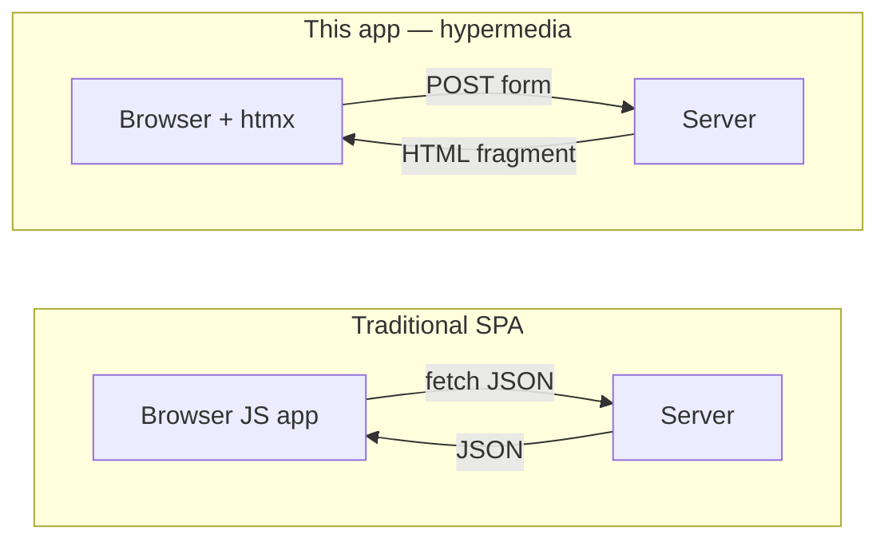
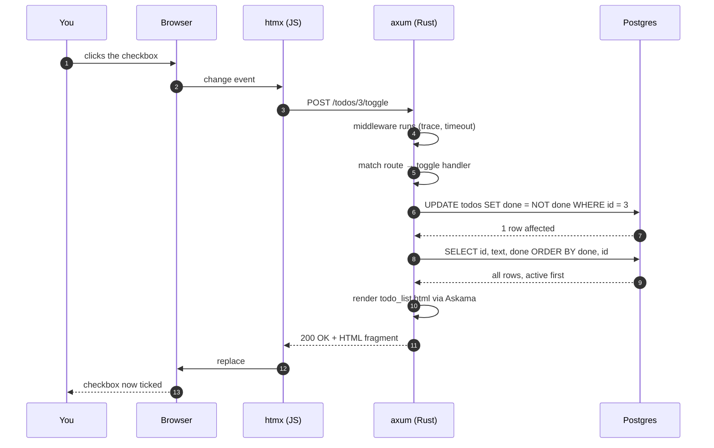
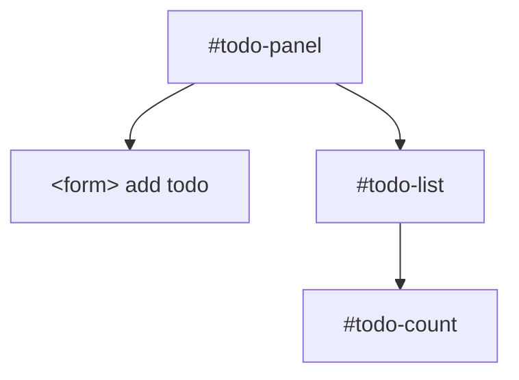
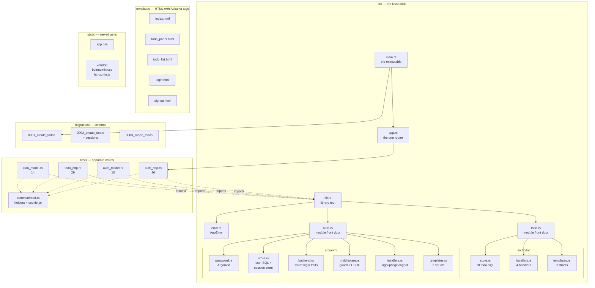
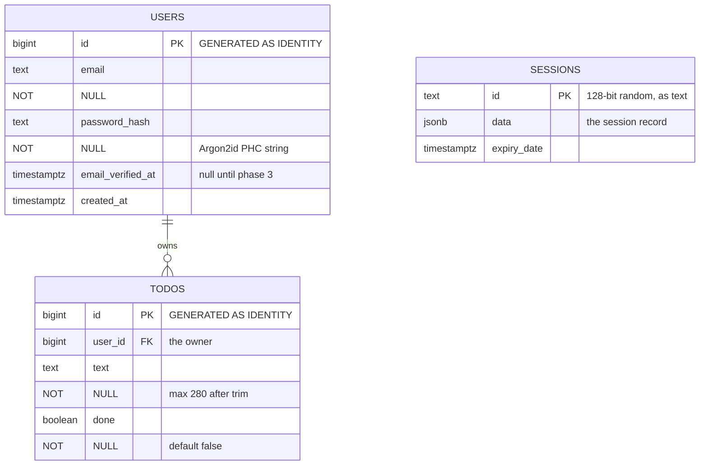
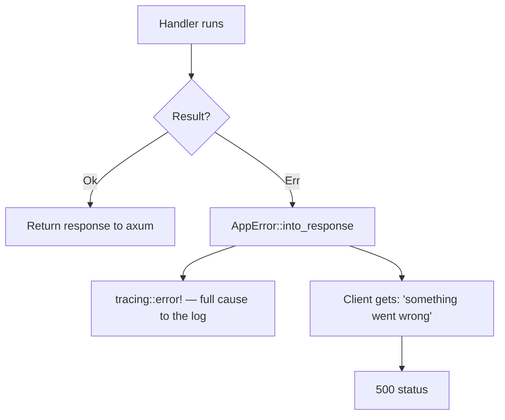
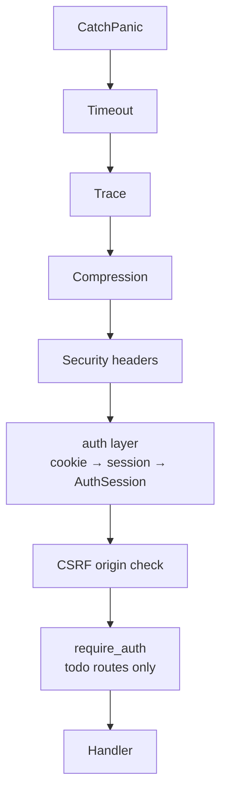
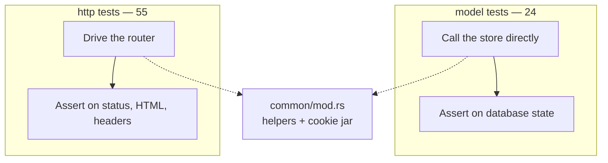
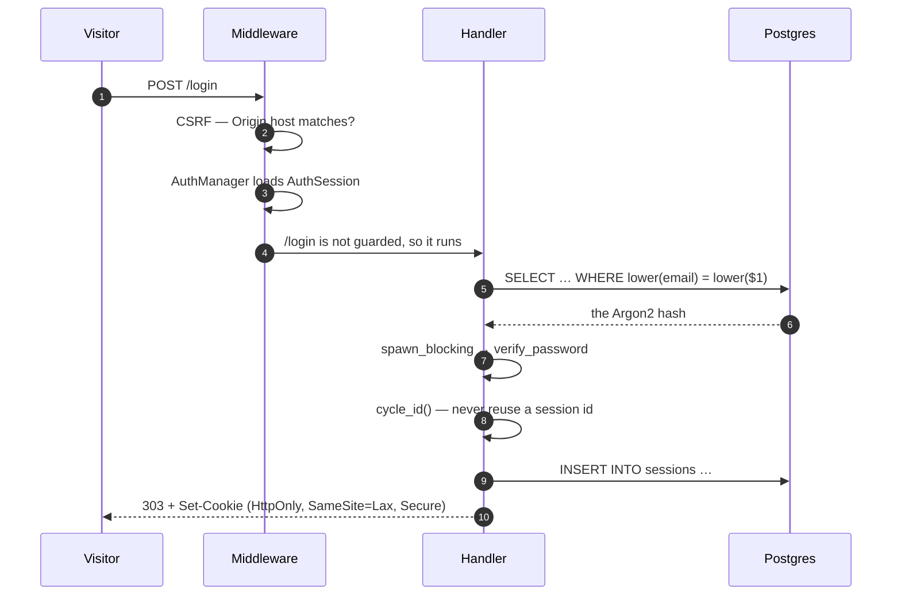

# Architecture & Concepts — a beginner's guide

Everything about this codebase, explained from first principles. No prior
knowledge of Rust, web servers, or databases is assumed.

- [1. What this app actually does](#1-what-this-app-actually-does)
- [2. The one request, end to end](#2-the-one-request-end-to-end)
- [3. How htmx changes the rules](#3-how-htmx-changes-the-rules)
- [4. File layout](#4-file-layout)
- [5. The stack: what each piece is for](#5-the-stack-what-each-piece-is-for)
- [6. Rust concepts you need](#6-rust-concepts-you-need)
- [7. The database layer](#7-the-database-layer)
- [8. Templates and the frontend](#8-templates-and-the-frontend)
- [9. Error handling](#9-error-handling)
- [10. Middleware](#10-middleware)
- [11. Testing](#11-testing)
- [12. Running and developing](#12-running-and-developing)
- [13. Security](#13-security)
- [14. Glossary](#14-glossary)

---

## 1. What this app actually does

A todo list, with accounts. You load a page, type a todo, press Enter, and it
appears. You can tick it off or delete it. Each account sees only its own list.

That is the entire product. Everything else in this document exists to serve
those four actions — and, since authentication arrived, the login and signup
forms in front of them.

**The important architectural decision** is that this is *not* a React-style
single-page app. There is no JSON API and no client-side JavaScript framework.
The server sends HTML fragments, and a tiny library called htmx swaps them into
the page. This is sometimes called a *hypermedia* architecture.



You get app-like smoothness without a build step, a bundler, or a frontend
framework — which is why there is no Node.js anywhere in this project.

---

## 2. The one request, end to end

Follow one interaction: **you tick a todo as done.**



The non-obvious parts:

**Step 3 — htmx intercepts the request.** The checkbox has
`hx-post="/todos/3/toggle"` on it. htmx sees that attribute, sends the request
via JavaScript, and stops the browser from doing a normal page load. Without
htmx, this would need a `<form>` and would reload the whole page.

**Step 5 — the route match.** axum looks at the method (`POST`) and the path
(`/todos/3/toggle`) and finds the `toggle` handler in `handlers.rs`.

**Step 6 — `NOT done` is the toggle.** `done` is a boolean, so `NOT done`
flips it in a single statement. No read-then-write round trip.

**Step 8 — why re-render the whole list?** Because the server is the only
source of truth. After a toggle, the *sort order changes* (done todos sink to
the bottom), so returning the freshly-sorted list is the simplest correct
answer. This app has no client-side state to keep in sync — that is the whole
point of hypermedia.

**Step 11 — the swap.** `hx-target="#todo-list"` and `hx-swap="outerHTML"` say
"replace the element with id `todo-list` using this new HTML".

---

## 3. How htmx changes the rules

htmx is 36KB of JavaScript with one idea: **HTML attributes trigger HTTP
requests, and the server's HTML response replaces part of the page.**

The four attributes used in this app:

| Attribute | Meaning |
|---|---|
| `hx-post="/todos"` | "when this element triggers, POST to this URL" |
| `hx-target="#todo-list"` | "put the response here" |
| `hx-swap="outerHTML"` | "replace the target element entirely" |
| `hx-confirm="Delete this todo?"` | "ask before sending" |

### The rule that shaped the code

Two elements in the panel swap: the add form and the list. They must **not**
swap together, or your half-typed todo would be thrown away on every tick.



So `toggle` targets `#todo-list`, never `#todo-panel`. There is a test
(`toggle_targets_the_list_not_the_panel`) that fails if anyone changes this. It
exists because this mistake is easy to make and hard to notice.

---

## 4. File layout



| File | Job |
|---|---|
| `src/lib.rs` | Declares `app`, `auth`, `todo`, `error`. Exists so tests can import the app. |
| `src/main.rs` | Loads `.env`, tracing, pool, migrations, router, serve. |
| `src/app.rs` | **The one router.** Session + auth layers live here so the tests get them too. |
| `src/error.rs` | The one error type, shared by every domain. |
| `src/todo.rs` | `Todo` struct, `TodoStore` alias, re-exports. |
| `src/todo/store.rs` | All todo SQL. Every query is scoped to a `user_id`. |
| `src/todo/handlers.rs` | Four handlers + the guarded router. |
| `src/todo/templates.rs` | The three Askama structs. |
| `src/auth.rs` | `User`, `CurrentUser`, the `AuthSession` alias, re-exports. |
| `src/auth/password.rs` | Argon2id hashing and the password policy. |
| `src/auth/store.rs` | User SQL **and** the Postgres `SessionStore`. |
| `src/auth/backend.rs` | The two traits axum-login requires. |
| `src/auth/middleware.rs` | `require_auth` and the CSRF origin check. |
| `src/auth/handlers.rs` | Signup, login, logout. |
| `src/auth/templates.rs` | Two Askama structs. |

### Why `lib.rs` exists at all

Rust allows `tests/*.rs` to import **only from a library**, never from a
binary. Before this split, the tests lived inside `src/todo.rs` as
`#[cfg(test)] mod tests` and that file had grown to 962 lines. Moving tests out
forced the library/binary split, and the source became readable again.

---

## 5. The stack: what each piece is for

| Crate / tool | One-line job |
|---|---|
| **tokio** | The async runtime. Provides the thread pool and the timers. |
| **axum** | The web framework. Routes, extractors, responses. |
| **tower** | The middleware system axum is built on. |
| **tower-http** | Ready-made middleware: logging, compression, headers. |
| **askama** | Templates compiled into Rust at build time. |
| **libsql** | Talks to Turso over HTTP (remote) or a local SQLite file (dev). |
| **serde** | Converts form data ↔ Rust structs. |
| **tracing** | Structured logging. |
| **axum-login** | The authentication layer: who is logged in, and how sessions work. |
| **password-auth** | Argon2id hashing and verification. |
| **sha2** | SHA-256, used to derive the session auth hash. |
| **htmx** | 36KB of JS: HTML attributes that fetch and swap. |
| **Bulma** | CSS framework. No JavaScript at all. |
| **Turso (libSQL)** | The database — cloud, reached over HTTP, or a local file in dev. |

### Why axum and not Rocket or Actix

axum is the most common modern choice, integrates cleanly with `tower`
middleware, and does not require nightly Rust. Its extractor model (next
section) is the part you will feel most.

### Why sqlx and not Diesel or an ORM

Diesel is compile-time checked but synchronous and heavy. An ORM hides SQL
behind a query builder. **sqlx** lets you write plain SQL, checks it at compile
time, and is async like the rest of axum.

### Why axum-login and not hand-rolled sessions

Three reasons, in order of weight:

1. **It owns the parts that are easy to get subtly wrong** — signing cookies,
   expiry, and rejecting a tampered session. Those are not where a small app
   should spend its risk budget.
2. **Session invalidation is free.** axum-login stores a `session_auth_hash` in
   the session and compares it against the current user on every request. Point
   that at the password hash and changing a password logs every other device out
   without a line of extra code.
3. **It is a small abstraction.** Two traits, `AuthUser` and `AuthnBackend`,
   plus an extractor.

### Why `tower-sessions-sqlx-store` is *not* used

The official Postgres store for `tower-sessions` depends on **sqlx 0.8**, while
this app is on **sqlx 0.9**. Two sqlx versions in one binary means two
incompatible `PgPool` types, and the pool here cannot be handed to it. The four
methods of the `SessionStore` trait are written out by hand in
`src/auth/store.rs` instead — about 90 lines, and it reuses the pool the app
already has.

---

## 6. Rust concepts you need

You do not need to learn all of Rust. These are the concepts that appear in this
codebase.

### `Result` — operations that can fail

Almost nothing in Rust panics on bad input; it returns a `Result`:

```rust
enum Result<T, E> {
    Ok(T),   // success, with a value
    Err(E),  // failure, with a reason
}
```

A function that can fail says so in its signature:

```rust
async fn add(pool: &PgPool, text: &str) -> Result<bool, AppError>
```

Read that as: "given a pool and some text, this returns either a `bool` (was it
inserted?) or an `AppError` (something broke)."

### `?` — the operator that saves the boilerplate

```rust
let todos = sorted(&pool).await?;   // if this fails, return the error now
```

`?` means: "if this is an `Err`, return it from this function immediately;
otherwise unwrap the `Ok` value and carry on."

**It only compiles because a `From` impl exists.** In `error.rs`:

```rust
impl From<sqlx::Error> for AppError { ... }
```

That impl is what lets `?` convert a `sqlx::Error` into an `AppError`. Without
it you would need `.map_err(|e| AppError::Database(e))?` everywhere.

### Ownership — the thing that makes Rust different

Every value has exactly one owner. When the owner goes out of scope, the value
is dropped. This is why you see `.clone()` and `&`:

```rust
async fn sorted(pool: &PgPool) -> Result<Vec<Todo>, AppError>
                  //  ^ borrow, not ownership
```

`&PgPool` means "I will look at this pool but not take it." Cheap, and the
caller can keep using it.

In `store.rs` you will see results being cloned:

```rust
let todos = sqlx::query_as(...)
    .fetch_all(pool)
    .await?;
Ok(todos)
```

`fetch_all` hands ownership of the `Vec` over. The clone is sometimes needed
when a value is used twice.

### `async` / `await` — waiting without blocking

A database query takes 5 milliseconds. A naive program would *block* — do
nothing — for those 5ms, wasting the thread.

`async`/`await` means "while I'm waiting, run other work on this thread":

```rust
let rows = sqlx::query_as(...)
    .fetch_all(pool)
    .await?;   // yields here; the runtime handles other requests
```

Every handler in `handlers.rs` is `async` for this reason.

### Traits — shared behaviour

A trait is a contract: "anything implementing this can do X."

```rust
pub trait IntoResponse {
    fn into_response(self) -> Response;
}
```

axum's rule is: **whatever a handler returns can become an HTTP response.**
`AppError` implements it — that is precisely why returning `Err(AppError)`
produces a clean 500 without any `match` in the handler.

### Enums with data — modelling alternatives

```rust
pub enum AppError {
    Render(askama::Error),   // variant carrying a value
    Database(sqlx::Error),   // another variant carrying a different value
}
```

This is *not* a tagged union you match on strings. The compiler checks you
handle every case, and each variant carries exactly the data it needs.

### `impl Trait for Type` — implementing a trait

Five of them in `error.rs`, each earning its place:

| Impl | What it does |
|---|---|
| `IntoResponse` | Turns an error into an HTTP 500. The whole point. |
| `From<askama::Error>` | Lets `?` convert a render failure. |
| `From<sqlx::Error>` | Lets `?` convert a query failure. |
| `Display` | Formats the error for humans. |
| `std::error::Error` | Makes it a real "error" so reporters can walk `source()`. |

### Modules and visibility

```rust
mod error;                    // private to this module
pub use error::AppError;      // but re-exported as todo::AppError
```

`mod` is private by default. `pub use` selectively exposes what callers need.
This is why the split into `todo/error.rs` etc. is invisible from outside.

---

## 7. The database layer

### The schema



```sql
create table users (
    id                bigint generated always as identity primary key,
    email             text not null,
    password_hash     text not null,
    email_verified_at timestamptz,
    created_at        timestamptz not null default now(),

    constraint users_email_length check (char_length(btrim(email)) between 3 and 254)
);

create unique index users_email_key on users (lower(email));

create table sessions (
    id          text primary key,
    data        jsonb not null,
    expiry_date timestamptz not null
);

create index sessions_expiry_idx on sessions (expiry_date);
```

Decisions, each with a reason:

**`unique index … on lower(email)`** — uniqueness is decided on the lowercased
address, so `Alice@example.com` and `alice@example.com` are the same account.
The stored value keeps the case the visitor typed; only the index normalises.
This is what makes case-insensitive uniqueness a one-liner instead of a
trigger.

**`sessions.id` is `text`, not `bigint`** — session ids are 128-bit random
integers, which do not fit in `bigint`. They are converted in
`src/auth/store.rs`.

**`sessions.data` is `jsonb`** — it holds a whole session record, which is a
structure rather than a couple of scalars. Both the write and the read ask for
`::jsonb` / `::text` explicitly, because sqlx binds a `String` as `text` and
Postgres will not cast it for you.

**`expiry_date` leads its index** — the cleanup task runs
`delete from sessions where expiry_date <= now()` on a timer.

### Todos belong to a user

```sql
alter table todos add column user_id bigint not null references users (id) on delete cascade;
create index todos_user_done_id_idx on todos (user_id, done, id);
```

**The `AND user_id = $2` on every query is the entire multi-user security
model.** There is no authorisation check in the handler, because ownership is
decided by the SQL itself:

```rust
// UPDATE todos SET done = NOT done WHERE id = $1 AND user_id = $2
let result = sqlx::query("UPDATE todos SET done = NOT done WHERE id = $1 AND user_id = $2")
    .bind(id)
    .bind(user_id)
    .execute(pool)
    .await?;
Ok(result.rows_affected() > 0)
```

Because `rows_affected()` is 0 for somebody else's todo, the handler answers
**404 — not 403**. That matters: a 403 would confirm the id exists.

**The index leads with `user_id`** because it is now the leading predicate on
every single query. An index on `(done, id)` would still be correct, but Postgres
would have to filter the whole table first.

**`ON DELETE CASCADE`** means a row can never outlive the account that owned it.

> **Migration 0003 deletes every existing todo.** Those rows predate accounts and
> have no owner to be migrated to. This is safe only because this database is a
> development one.

### The queries

All of them, and why each returns what it does:

```rust
// sorted: active first, then completed, insertion order within each group
SELECT id, text, done FROM todos WHERE user_id = $1 ORDER BY done ASC, id ASC

// open_count: the "N open" line
SELECT count(*) FROM todos WHERE user_id = $1 AND NOT done

// add: text arrives trimmed and validated
INSERT INTO todos (text, user_id) VALUES ($1, $2)

// flip_done: the whole toggle in one statement
UPDATE todos SET done = NOT done WHERE id = $1 AND user_id = $2

// remove
DELETE FROM todos WHERE id = $1 AND user_id = $2
```

**Why `ORDER BY done ASC` puts active first:** in Postgres `false` sorts before
`true`. So unfinished todos (`done = false`) come first. The old in-memory code
did `sort_by_key(|t| t.done)` — the same thing.

**Why mutations return `bool`:**

```rust
let result = sqlx::query("DELETE FROM todos WHERE id = $1 AND user_id = $2")
    .bind(id)
    .bind(user_id)
    .execute(pool)
    .await?;
Ok(result.rows_affected() > 0)
```

`rows_affected()` is a count *from the database*. Deleting id 9999 genuinely
affects zero rows, so the handler returns **404**. Not a guess — a fact.

### Migrations

`sqlx::migrate!()` embeds the `migrations/` folder **into the binary at compile
time**, then runs any unapplied files at startup. Consequences:

- Deploying needs no separate migration step.
- The schema always matches the code that shipped with it.
- Migrations run in filename order and are recorded in `_sqlx_migrations`.

sqlx takes a Postgres **advisory lock** first, so if several instances boot at
once they queue rather than racing.

---

## 8. Templates and the frontend

### Askama: HTML compiled into Rust

A template is HTML plus a few tags:

```html

  <li class="todo-row">{{ todo.text }}</li>

```

`{{ todo.text }}` prints a variable. **It is escaped automatically** — `<`
becomes `&#60;`, `"` becomes `&quot;`. That single fact is the app's entire
XSS defence.

Templates are parsed at **build time**. A template referencing a field that
does not exist is a compile error, not a runtime failure. Because the HTML is
baked into the binary, editing a template requires a rebuild.

### Three templates, three jobs

| Template | Rendered by | Contains |
|---|---|---|
| `index.html` | `GET /` | `<head>`, all CSS/JS links, includes the panel |
| `todo_panel.html` | `POST /todos` | the add form, includes the list, the count |
| `todo_list.html` | toggle, delete | just the `<ul>` of todos |

`` is how they compose — the same list fragment is reused in two
different responses, so it exists in exactly one file.

### Bulma: the design system

Bulma supplies layout, components, spacing, and dark mode. It ships **zero
JavaScript**. `app.css` is a thin layer on top:

- **Re-hues Bulma's variables** — `--bulma-primary-h/s/l` — which re-derives
  buttons, links, and focus rings from one change.
- **Adds gradient utilities** — Bulma has no gradient primitive; gradients are
  just `background-image`, so they never conflict.
- **Styles `todo-list`** — the one thing Bulma has no component for.

Bulma and htmx are **vendored** into `static/vendor/` rather than loaded from a
CDN. Reasons: no third party sees visitors' IPs, and the app has no runtime
network dependency.

---

## 9. Error handling

Every handler returns `Result<_, AppError>`. `AppError` lives at `src/error.rs`
rather than inside `todo/`, because authentication can fail too and no domain
should own the error the other one returns.



| Variant | Means | Client sees |
|---|---|---|
| `Render` | A template failed to build | 500 |
| `Database` | A query failed | 500 |
| `Hashing` | The blocking hash task panicked | 500 |
| `Session` | The session layer refused | 500 |
| `Unauthenticated` | A handler ran with no session — a bug | **401** |

`Unauthenticated` is the only variant that is not a server fault, so it is the
only one that is not a 500.

The split matters for security. The real cause — which may contain table names,
file paths, or SQL — goes to the server log. The client gets a fixed string.
A leaked error message is how internal structure gets exposed.

### Why not `anyhow`

`anyhow` is for applications that just want to bail with a message. It is a
type-erased box that **cannot** implement `IntoResponse`. Since this error must
become an HTTP status code, a concrete enum is the correct tool. Having both
would mean two error systems doing one job.

---

## 10. Middleware

Middleware wraps the request handler. Each `.layer()` call wraps everything
before it, so **the last call is outermost**:



Order is deliberate:

- **CatchPanic outermost** — so it catches a panicking handler first and turns
  it into a readable 500 instead of a dropped connection.
- **Timeout outside that** — so a hung request still unwinds through the panic
  layer instead of vanishing.
- **Trace outside the timeout** — so even a hung request gets logged.
- **Compression outermost of the app's own layers** — so it compresses the
  finished response.
- **The auth layer sits below all of them.** It is the outermost of the layers
  inside `build_app`, because it is what puts `AuthSession` into the request
  extensions that `require_auth` reads.

### The guard is scoped to the todo routes

```rust
// src/todo/handlers.rs
Router::new()
    .route("/", get(index))
    // …the other three
    .route_layer(middleware::from_fn(crate::auth::require_auth))
```

`route_layer` applies to the routes defined in **that** router and no others. So
`/` and the todo endpoints require a session, while `/login` and `/signup` —
merged in separately by `src/app.rs` — stay reachable. A todo route added here
is protected automatically; forgetting to guard it is not a mistake you can make.

### Why the router lives in `app.rs`

`main.rs` used to build the router itself. If the auth layer had been added
there, it would have been **absent from every test**. `app::build_app` is called
by both, so `cargo test` drives real session cookies, a real login guard and a
real CSRF check.

### How htmx and the guard cooperate

A 303 is the right answer for a browser following a link and completely wrong
for htmx: htmx would swap a whole login page into `#todo-list`, leaving the
visitor stuck in the middle of their list. So `require_auth` branches on the
`HX-Request` header htmx sets:

| Request | Response |
|---|---|
| Normal GET `/` | `303` to `/login?next=%2F` |
| htmx GET `/` (has `HX-Request`) | `200` with `HX-Redirect: /login` |

### The security headers

| Header | Value | Why |
|---|---|---|
| `Content-Security-Policy` | `default-src 'self'; script-src 'self'; …` | Blocks injected scripts even if escaping fails |
| `X-Content-Type-Options` | `nosniff` | Stops the browser guessing a content type |
| `Referrer-Policy` | `no-referrer` | Do not leak URLs to third parties |

**One caveat to know:** htmx calls `new Function()` for `hx-on`, `hx-vals` and
`hx-sync` when given JS strings. `script-src 'self'` blocks those. This app does
not use them — but adding one later will fail, confusingly, until the policy is
adjusted.

---

## 11. Testing

79 tests, in four files, split by **layer** so a failure tells you where the bug
is.



| Layer | Tests | A failure means |
|---|---|---|
| `todo_model.rs` | 14 | The todo SQL or the data rules are wrong |
| `todo_http.rs` | 29 | A todo handler, template, or route is wrong |
| `auth_model.rs` | 10 | Hashing, the uniqueness rule, or the policy is wrong |
| `auth_http.rs` | 26 | The guard, the session, or CSRF is wrong |

### `#[sqlx::test]` — a database per test

```rust
#[sqlx::test]
async fn toggle_flips_state(pool: PgPool) {
    let me = user_id(&pool).await;
    add(&pool, me, "a").await.unwrap();
    // …
}
```

For Postgres this **creates a brand new database for that one test**, applies
`migrations/` to it, and drops it afterwards. That is why tests run in parallel
without interfering.

The cost: **tests need a running Postgres.** If it is not up, `cargo test`
fails immediately.

### `oneshot` — a real request with no server

```rust
let app = app::build_app(pool.clone(), AppConfig::default());
let res = app.oneshot(request).await.unwrap();
```

`oneshot` drives one request through the whole `Router` — real routing, real
extractors, real middleware, **real sessions** — but no socket, no port, no
background task. Fast and parallel-safe.

Because it goes through `build_app`, the tests exercise the same session layer,
login guard and CSRF check that `cargo run` does. There is no mock of
authentication anywhere in this suite.

### The cookie jar

Almost every request now needs a session. `Client` in `common/mod.rs` is a very
small cookie jar:

```rust
let mut client = Client::signed_up(&pool, "alice@example.com").await;
let (status, body) = client.post_todo(&pool, "buy milk").await;
```

`Client::signed_up` goes through the **real signup handler** rather than
inserting a row, so signing up is itself under test. After each request the jar
records whatever `Set-Cookie` the response carried and sends it back next time —
which is what a browser does, and what the session layer expects.

It also handles the logout case correctly: an expired cookie with the same name
*replaces* the stored one, so a signed-out client really is signed out.

### How tests stay honest

Some tests assert on a **slice** of the HTML rather than the whole page:

```rust
let checkbox = body
    .split_once("todo-toggle").unwrap()   // after this marker
    .1
    .split_once('>').unwrap()             // up to the tag's end
    .0;
assert!(checkbox.contains("hx-target=\"#todo-list\""));
```

The page legitimately contains real `<script>` tags, so a naive "no script here"
assertion would be meaningless. Narrowing to the element under test keeps the
assertion honest.

---

## 12. Running and developing

### First-time setup

Create a Turso database and an auth token:

```bash
turso db create practice
turso db tokens create practice
```

Then put the values in `.env`:

```
DATABASE_URL=libsql://<your-db>.turso.io
DATABASE_AUTH_TOKEN=<your-token>
```

`.env` is gitignored — it contains a secret. `.env.example` is the committed
template listing every variable with its default.

> For local development without a network, leave `DATABASE_URL` unset and the
> app falls back to `file:practice.db` (a local SQLite file).

### Commands

| Command | What it does |
|---|---|
| `cargo run` | Start the server on `127.0.0.1:3000` |
| `cargo test` | All 97 tests (uses an in-memory database; no external DB needed) |
| `cargo watch -w src -w templates -x run` | Rebuild + restart on any change |

### Configuration

| Variable | Default | Purpose |
|---|---|---|
| `DATABASE_URL` | *(required)* | `libsql://...` Turso URL, or `file:practice.db` for local dev |
| `DATABASE_AUTH_TOKEN` | *(required for remote)* | Turso auth token (`turso db tokens create`) |
| `ADDR` | `127.0.0.1:3000` | Listen address |
| `SESSION_SECURE` | `true` | Adds `Secure` to the session cookie. **Set `false` only for local http** — a `Secure` cookie is never sent over plain http, so on a public deployment this logs everybody out. |
| `APP_ALLOWED_HOST` | `localhost:3000` | The `host[:port]` CSRF accepts on POST/PUT/PATCH/DELETE |
| `RUST_LOG` | `info` | Log filter; `debug` logs every request |

`.env.example` is the committed template.

### Why `templates` must be in the watch list

Askama compiles templates into the binary, so editing `todo_list.html` changes
nothing until a rebuild. That is why `-w templates` is there. CSS and JS in
`static/` are served from disk, so those only need a browser refresh.

---

## 13. Security

What is protected, and by what:

| Threat | Defence |
|---|---|
| **SQL injection** | Every value is `.bind()`-ed, never interpolated. Proven by a test that stores `'; drop table todos; --` verbatim. |
| **XSS** | Askama escapes all output. Proven by seeding 8 payloads and asserting no raw `<` survives in the text node. |
| **Attribute breakout** | Same escaping, in attribute position. Tested via the delete button's `aria-label`. |
| **Injection in a URL** | `Path(id): Path<i64>` — a non-numeric id is rejected with 400 before any handler runs. |
| **XSS as a backstop** | CSP with `script-src 'self'` |
| **Resource exhaustion** | `MAX_TEXT_LEN` (280), the password length cap, and the `CHECK` constraints |
| **Slowloris** | 15s `TimeoutLayer` |
| **Panics leaking internals** | `CatchPanicLayer` → 500, cause to the log only |
| **Reading someone else's todos** | `AND user_id = $2` on every query → 404, which does not confirm the id exists |
| **Password theft from a database dump** | Argon2id at 19 MiB, per-password salt. Proved: the column holds a `$argon2id$…` PHC string, never the password. |
| **Brute force / credential stuffing** | Argon2's cost *plus* a dummy hash on unknown emails, so timing cannot be used to enumerate accounts |
| **Session theft via XSS** | `HttpOnly` on the session cookie |
| **Session theft in transit** | `Secure` in production (`SESSION_SECURE`) |
| **CSRF** | `SameSite=Lax` **and** an `Origin`/`Referer` host check on POST/PUT/PATCH/DELETE |
| **Session fixation** | The session id is rotated on every login |
| **XSS in an email address** | Askama escapes it on the dashboard and in the signup form's `value` |
| **Open redirect** | `?next=` accepts only a local path; `//evil.com` and `/\evil.com` are rejected |
| **Logout by a third party** | `POST /logout` only — a GET would let any page end a session with an `` |
| **Leaking a password hash into the session store** | `session_auth_hash` is a SHA-256 *of* the hash, so the Argon2 string never leaves the `users` table |

### How the pieces fit



**Timing is deliberate on the login path.** When the account does not exist, the
handler still runs a full Argon2 verification against a throwaway hash, so the
response takes the same time either way. Without that, "no such user" returns in
microseconds while a real account takes ~50ms, and that difference alone lists
every address on the site. Both failures then return the **byte-identical**
response "Invalid email or password."

**Argon2 runs on the blocking pool.** At 19 MiB per hash it burns ~50ms of CPU.
On a tokio worker thread that would stall every other request sharing it, so
every call goes through `tokio::task::spawn_blocking`.

**Signup is the one place a duplicate email is visible**, because a visitor
registering an address already in use has to be told. That is an accepted
trade-off: at signup the visitor is about to learn the address exists anyway,
and the alternative is making signup fail silently. Login, forgot and reset all
stay identical whether or not the account exists.

### The gaps that remain

- **No rate limiting.** `/login`, `/signup` and (from phase 4) `/forgot` have no
  request cap. Argon2's cost slows an attacker but does not stop them.
- **No email verification or password reset.** Both are phase 3 and 4.
- **No HTTPS.** `SESSION_SECURE` assumes a proxy terminates TLS; nothing in the
  app configures TLS itself.
- **No backups**, and no request IDs for log correlation.

---

## 14. Glossary

| Term | Meaning |
|---|---|
| **Router** | The map from method + path to handler |
| **Extractor** | How axum pulls typed data from a request (`State`, `Path`, `Form`) |
| **Middleware** | Code wrapping every request; a layer in a pipeline |
| **Fragment** | HTML for a piece of a page, not a whole document |
| **Hypermedia** | Server returns HTML to be rendered, not JSON to be processed |
| **Swap** | htmx replacing part of the DOM with a server response |
| **Middleware order** | Last `.layer()` call is the outermost |
| **Tower** | The middleware framework axum is built on |
| **Turbofish** | `::<_, Todo>` — naming a type explicitly at a call site |
| **`#[derive]`** | Generate trait implementations from a struct |
| **Advisory lock** | A Postgres lock applications use to coordinate with each other |
| **`rows_affected()`** | How many rows a statement actually changed |
| **`identity`** | A Postgres column that auto-generates sequential ids |
| **`CHECK`** | A constraint; the database rejects violating rows |
| **Session** | Server-side state tied to a cookie; holds the logged-in user id |
| **CSRF** | Forging a request from another site so it rides the victim's cookies |
| **Session fixation** | Planting a session id in a victim's browser before they log in |
| **Argon2id** | A memory-hard password hash; the current best choice |
| **PHC string** | One self-describing line holding algorithm, params, salt and digest |
| **Dummy hash** | A real hash of an unknown password, spent so timing cannot enumerate accounts |
| **`spawn_blocking`** | Moves CPU work off the async worker threads, for things like hashing |
| **`route_layer`** | A `.layer()` that applies only to the routes in that one `Router` |
